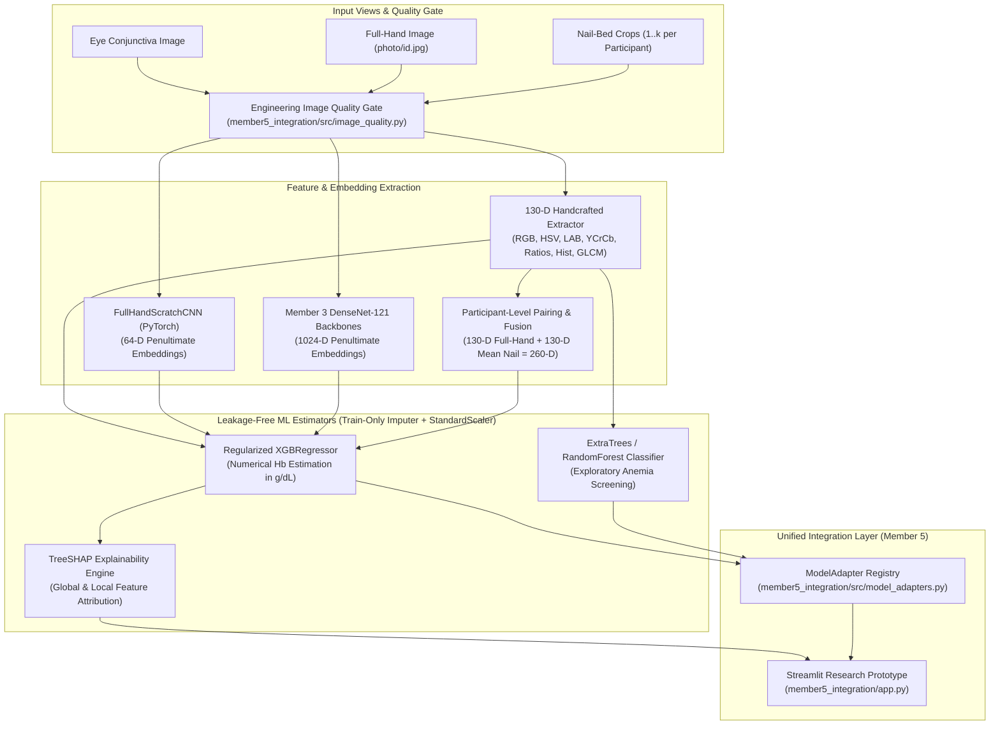

# Final Project Report — Hybrid AI-Based Non-Invasive Hemoglobin Estimation: A Feasibility Study Using Image-Derived Features

> **Academic Research Prototype Disclaimer**  
> **Academic research prototype only.** This software and its underlying machine-learning models are developed strictly for educational and research purposes as part of a five-member undergraduate computer science / engineering capstone project. It is **not** a clinical diagnostic device, has **not** been clinically validated or approved by any regulatory body, must **not** be used to replace laboratory Complete Blood Count (CBC) testing, and must **not** be used to provide medical advice, clinical diagnosis, or treatment recommendations.

---

## 1. Title

**Hybrid AI-Based Non-Invasive Hemoglobin Estimation: A Feasibility Study Using Image-Derived Features**

---

## 2. Abstract

Laboratory hemoglobin (Hb) measurement via venous blood draw and Complete Blood Count (CBC) testing remains the clinical standard for diagnosing and monitoring anemia, yet invasive sampling requires specialized equipment, consumables, and trained personnel. This five-member academic feasibility study investigates whether non-invasive digital photographs of peripheral anatomical sites—specifically palpebral conjunctiva (eye), fingernail beds, and full dorsal/palmar hand views—can support numerical Hb estimation (g/dL) and exploratory anemia screening using machine-learning models under strict participant-level data partitioning. Across three distinct datasets (EDI Eye dataset with 202 participants and 610 deduplicated images; Figshare Hb Preprocessed Nail & Hand dataset with 250 participants, 250 full-hand photographs, and 719 nail-bed crops; and an auxiliary Palm classification dataset with 526 source groups and 2,104 deduplicated images lacking numerical Hb targets), we evaluate 130-dimensional interpretable handcrafted color, histogram, spatial, and texture features alongside deep Convolutional Neural Network (CNN) embeddings coupled with gradient-boosted decision trees (`XGBRegressor`) and ensemble classifiers.

On held-out test participants, handcrafted feature models achieved **MAE = 1.4177 g/dL, RMSE = 1.9744 g/dL, and R² = 0.4912** on the Eye dataset ($n = 89$ deduplicated test images across $31$ test participants) and **MAE = 1.5819 g/dL, RMSE = 2.0355 g/dL, and R² = 0.3157** on the Figshare Full-hand dataset ($n = 38$ test participants). A task-specific 64-dimensional Scratch-CNN trained strictly on the 175 Full-hand training participants followed by XGBoost regression achieved **MAE = 1.5599 g/dL, RMSE = 1.8946 g/dL, and R² = 0.4072** on the same 38 held-out test participants. Furthermore, an automated participant-level pairing audit confirmed a 100% match across all 250 Figshare participants between Full-hand photographs (`250` rows) and Nail-bed crops (`719` rows; $1\text{–}3$ crops per participant), enabling a leakage-free paired multi-view feature fusion experiment (`260` combined handcrafted features) that achieved **MAE = 1.6792 g/dL, RMSE = 2.2338 g/dL, and R² = 0.1759**—improving over participant-level Nail-only regression (**MAE = 1.8289 g/dL**) though not surpassing Full-hand-only regression (**MAE = 1.5819 g/dL**), reflecting that both views originate from the same source hand photograph (`photo/<id>.jpg`). Global and local TreeSHAP explainability analyses, engineering image-quality checks, automated unit tests (`31/31` passing), and a modular Streamlit research prototype complete the end-to-end academic framework.

---

## 3. Problem Statement

Anemia—characterized by a reduced concentration of hemoglobin in peripheral blood—is a widespread global health condition affecting billions of individuals, particularly in resource-limited settings where routine venous blood draws and laboratory hematology analyzers may not be readily accessible. Over the past decade, computer vision researchers have explored whether visible pallor in vascularized peripheral tissues (such as the palpebral conjunctiva, nail beds, and palmar skin) can be quantified from consumer-grade digital photographs to estimate blood hemoglobin concentration non-invasively.

However, many early studies in image-based hemoglobin estimation suffer from critical methodological pitfalls:
1. **Image-level data leakage:** Splitting augmented images or multiple crops from the same participant randomly across training and test sets, inflating reported accuracy via subject memorization.
2. **Conflation of datasets and tasks:** Treating datasets that only contain binary folder labels (`Anemic` vs. `Non-anemic`) as if they support continuous numerical Hb regression, or treating crops extracted from a single photograph as independent multi-sensor modalities.
3. **Lack of fair baselines and interpretability:** Presenting deep neural networks without comparing them against transparent, domain-specific color/texture baselines under identical participant splits, or deploying black-box predictions without feature attribution and input quality safeguards.

This project addresses these challenges by conducting a rigorous, leakage-free feasibility study that evaluates handcrafted image features, CNN embeddings, and paired multi-view feature fusion on verified numerical Hb targets, accompanied by TreeSHAP explainability and an interactive academic demonstration interface.

---

## 4. Project Objectives

1. **Data Integrity & Leakage Prevention:** Audit all available project datasets (`dataset_edi_eyes.zip`, `Figshare_Hb_Preprocessed_nail_skin.zip`, `PalmDataset.zip`, and `member3_model_training.zip`), remove exact duplicate images (`MD5` hashing), verify numerical Hb measurements (g/dL), and enforce strict participant-level `70% / 15% / 15%` (`train / validation / test`) splits with zero participant overlap.
2. **Handcrafted Feature Baseline:** Design and extract a standardized 130-dimensional handcrafted feature vector capturing multi-color-space statistics (`RGB`, `HSV`, `LAB`, `YCbCr`), redness/pallor ratios, normalized intensity histograms, central-vs-border spatial statistics, and Gray-Level Co-occurrence Matrix (`GLCM`) texture descriptors.
3. **Handcrafted vs. CNN Embedding Comparison:** Train regularized `XGBRegressor` models on verified numerical Hb targets using handcrafted features, Member 3 pretrained CNN embeddings (`1024-D`), and a task-specific Member 4 Full-hand Scratch-CNN (`64-D` embeddings) under identical participant-level splits.
4. **Paired Multi-View Feature Fusion:** Conduct a formal participant-level pairing audit between Figshare Nail crops and Full-hand images, aggregate variable-count nail crops per participant, and evaluate a 260-dimensional paired feature fusion model against single-view baselines on the identical 38 held-out test participants.
5. **Model Explainability & Quality Safeguards:** Implement `shap.TreeExplainer` (TreeSHAP) global and local explanations on the 130 interpretable handcrafted features, contrast them with the opacity of deep CNN embedding dimensions, and implement pre-inference engineering image-quality checks.
6. **System Integration & Interactive Prototype:** Wrap all verified models in a unified `ModelAdapter` interface (`member5_integration/src/model_adapters.py`), verify exact numerical reproducibility via automated unit tests (`pytest`), and build a safe, read-only Streamlit research prototype (`member5_integration/app.py`).

---

## 5. Scope and Ethical Boundary

This project operates within strict scientific and ethical boundaries:
- **Academic Research Prototype Only:** All software, models, metrics, and visual interfaces in `Anemia_ML_Project` are strictly for academic demonstration and machine-learning feasibility analysis.
- **Not a Clinical Diagnostic System:** The models have not undergone clinical trials, prospective multi-center validation, or regulatory review. Test errors of **MAE $\approx 1.42\text{–}1.83$ g/dL** and **RMSE $\approx 1.89\text{–}2.41$ g/dL** are substantial relative to clinical decision thresholds.
- **No Replacement for Laboratory CBC:** Predictions generated by this system must never be used to diagnose anemia, rule out hematological disorders, guide iron supplementation, or replace a laboratory Complete Blood Count (CBC).
- **Uncalibrated Screening Probabilities:** Exploratory classification outputs represent uncalibrated statistical scores evaluated against dataset-specific Hb cutoffs (`< 11.0 g/dL` across datasets where sex/pregnancy metadata are unavailable) or folder labels; they do not represent calibrated clinical risk probabilities.
- **No Cross-Subject Fabrication:** Cross-dataset multimodal fusion (e.g., combining an Eye photograph from one dataset with a Nail or Palm photograph from a different dataset) is scientifically invalid because those datasets contain different human cohorts (`eye_extracted` vs. `figshare_extracted` vs. `palm_extracted`). Only verified same-participant paired views (`Figshare` Full-hand + Nail crops) are fused.

---

## 6. Dataset Source and Licensing / Access Status

The workspace `Anemia_ML_Project/datasets/` contains four primary archives inspected and audited during the study:

| Archive / Directory | Anatomical View(s) | Total Verified Subjects / Groups | Deduplicated Images / Crops | Target Type | Upstream Source & Licensing Status |
| :--- | :--- | :---: | :---: | :--- | :--- |
| `dataset_edi_eyes.zip` (`eye_extracted/`) | Palpebral conjunctiva / scleral eye photographs (`India` & `Italy` sub-cohorts) | `202` participants (`85` India, `117` Italy; `1` subject without Hb excluded) | `610` deduplicated images (from `756` raw files; `146` exact duplicates removed) | Numerical Hb (`g/dL`, range `7.0–17.4 g/dL`) | Derived from the published Eyes-Defy-Anemia (EDI) dataset (Dimauro et al.). **Upstream dataset licensing and redistribution terms require formal confirmation before any public or external release.** |
| `Figshare_Hb_Preprocessed_nail_skin.zip` (`figshare_extracted/`) | Paired Full-hand photographs (`full/`) and cropped fingernail beds (`nail/`) from `photo/<id>.jpg` | `250` participants (`participant_id` `1` to `342`) | `250` Full-hand images + `719` valid Nail crops (`1` corrupted 0-byte file `0236_nail_1.jpg` excluded) | Numerical Hb (`g/dL`, converted from `g/L` via $\div 10.0$, range `6.5–17.7 g/dL`) | Preprocessed derivative of a public Figshare hand/nail hemoglobin dataset. **Upstream dataset licensing and redistribution terms require formal confirmation before any public or external release.** |
| `PalmDataset.zip` (`palm_extracted/`) | Palmar hand photographs (`Anemic` vs. `Non-anemic` folders, heavily augmented) | `526` source palm groups | `2,104` deduplicated images (from `4,261` raw files; `2,157` exact duplicates removed) | Binary folder label only (`0` = Non-anemic, `1` = Anemic); **no numerical Hb values exist** | Publicly shared academic palm anemia classification archive. **Upstream dataset licensing and redistribution terms require formal confirmation before any public or external release.** |
| `member3_model_training.zip` (`member3_extracted/`) | Pretrained DenseNet-121 checkpoints (`eye`, `nail`, `palm`) and Member 3 training scripts | — | `3` PyTorch `.pt` checkpoints (`1024-D` backbone embeddings) | Classification checkpoints repurposed as frozen feature extractors | Internal team handover archive from Member 3. |

> [!IMPORTANT]
> **Licensing & Redistribution Note:** While all datasets were provided within the academic course workspace for internal research and evaluation, upstream dataset licenses (e.g., CC-BY / academic research-only restrictions, patient consent terms for facial/ocular photographs) **have not been independently verified for public redistribution**. Raw participant photographs must not be republished in public code repositories without verifying the original dataset licenses.

---

## 7. Data Dictionary

### 7.1 Split & Metadata Tables (`member4_ml_modelling/outputs/features/`)

| File Name | Granularity | Rows | Key Columns | Description |
| :--- | :--- | :---: | :--- | :--- |
| `eye_clean_splits.csv` | Deduplicated Eye image | `610` | `image_path`, `participant_id`, `country`, `hb_g_dl`, `anemia_label`, `split`, `md5` | Master deduplicated manifest for the EDI Eye cohort (`202` participants across `train`/`val`/`test`). |
| `nail_skin_full_splits.csv` | Participant / Full-hand image | `250` | `participant_id`, `hb_g_dl`, `anemia_label`, `source_image`, `image_path`, `split` | Master manifest for Figshare Full-hand photographs (`1` row per participant). |
| `nail_skin_nail_splits.csv` | Cropped Nail-bed ROI | `719` | `participant_id`, `hb_g_dl`, `anemia_label`, `source_image`, `image_path`, `crop_index`, `split` | Master manifest for Figshare Nail-bed crops (`1–3` crops per participant, mean `2.88`). |
| `palm_clean_splits.csv` | Deduplicated Palm image | `2,104` | `image_path`, `group_id`, `anemia_label`, `split`, `md5` | Master deduplicated manifest for the auxiliary Palm classification dataset (`526` source groups). |

### 7.2 Paired Audit & Feature Matrices

| File Name | Shape | Key Columns / Structure | Description |
| :--- | :---: | :--- | :--- |
| `member5_integration/outputs/fusion/pairing_audit.csv` | `250 × 10` | `participant_id`, `split`, `hb_g_dl`, `anemia_label`, `source_image`, `full_hand_image_path`, `nail_crop_count`, `nail_crop_paths`, `hb_match_across_views`, `split_match_across_views` | Formal verification ledger proving 1-to-1 participant alignment between Full-hand and Nail views. |
| `eye_handcrafted_features.csv` | `610 × 137` | `7` metadata columns + `130` handcrafted features | Extracted 130-D handcrafted features for the Eye dataset. |
| `nail_handcrafted_features.csv` | `719 × 137` | `7` metadata columns + `130` handcrafted features | Extracted 130-D handcrafted features for every valid Nail-bed crop. |
| `full_hand_handcrafted_features.csv` | `250 × 136` | `6` metadata columns + `130` handcrafted features | Extracted 130-D handcrafted features for every Full-hand photograph. |

---

## 8. Participant-Level Split Strategy

A central scientific requirement of this study is **zero participant-level data leakage**. When a participant contributes multiple photographs (such as `2–5` eye photographs per subject in the EDI dataset, `1–3` nail crops plus `1` full-hand image per subject in the Figshare dataset, or `4` rotated/augmented palm images per source palm in the Palm dataset), random image-level splitting places images of the same person into both training and test sets. This allows models to memorize subject-specific skin tone, background lighting, or camera artifacts rather than learning hemoglobin-related features.

To prevent leakage:
1. **Grouped Stratified Partitioning (`70% Train / 15% Validation / 15% Test`):** All splits were generated at the **participant ID** (or `group_id` for Palm) level using fixed random seed `42`, stratified by Hb quartile (for numerical Hb datasets) or binary class (for Palm).
2. **Exact Cross-View Split Alignment:** In the Figshare dataset, `nail_skin_full_splits.csv` and `nail_skin_nail_splits.csv` share the exact same participant-level partition (`175` training participants, `37` validation participants, `38` test participants).
3. **Training-Only Fit Policy:** Every preprocessing transformation—specifically median imputation (`SimpleImputer(strategy="median")`), feature standardization (`StandardScaler`), CNN backbone training (`FullHandScratchCNN`), and hyperparameter selection—was fitted strictly on the `train` split (`n = 175` participants for Figshare; `n = 141` participants / `432` images for Eye), tuned on `val`, and evaluated once on `test`.

| Dataset / View | Train Participants (Images/Crops) | Val Participants (Images/Crops) | Test Participants (Images/Crops) | Total Participants (Images/Crops) | Participant Overlap Across Splits |
| :--- | :---: | :---: | :---: | :---: | :---: |
| **EDI Eye** | `141` (`432` images) | `30` (`89` images) | `31` (`89` images) | `202` (`610` images) | **`0`** |
| **Figshare Full-hand** | `175` (`175` images) | `37` (`37` images) | `38` (`38` images) | `250` (`250` images) | **`0`** |
| **Figshare Nail Crops** | `175` (`503` crops) | `37` (`107` crops) | `38` (`109` crops) | `250` (`719` crops) | **`0`** |
| **Palm Classification** | `368` (`1,472` images) | `85` (`340` images) | `73` (`292` images) | `526` (`2,104` images) | **`0`** |

---

## 9. Data Preprocessing and Quality Checks

### 9.1 Dataset Cleaning & Preprocessing (Member 4 Pipeline)
- **Exact Duplicate Removal:** MD5 file digests were computed across all archives. In the Eye dataset, `146` exact duplicate image files (caused by mirrored folder structures) were removed (`756` $\rightarrow$ `610` images). In the Palm dataset, `2,157` exact duplicates were removed (`4,261` $\rightarrow$ `2,104` images).
- **Corrupted File Filtering:** In `figshare_extracted/nail/`, file `0236_nail_1.jpg` was identified as a 0-byte unreadable file and excluded (`720` $\rightarrow$ `719` valid crops; participant `236` still retains valid crops `0236_nail_2.jpg` and `0236_nail_3.jpg`).
- **Hb Unit Standardization:** Figshare metadata recorded hemoglobin in grams per liter (`g/L`, e.g., `138.0 g/L`). These values were verified and standardized to grams per deciliter (`g/dL`, `13.8 g/dL`) via division by `10.0` to match the EDI Eye dataset (`g/dL`).
- **Central ROI Cropping for Handcrafted Features:** Before extracting handcrafted features (`member4_ml_modelling/src/feature_extraction.py`), each image is converted to `RGB`, resized to `224 × 224` using bilinear interpolation, and cropped to its central `70%` window (`[33:190, 33:190]`, `157 × 157` pixels) to attenuate peripheral background clutter while retaining tissue chroma.

### 9.2 Pre-Inference Engineering Image Quality Checks (Member 5 Integration)
To prevent corrupted, blank, severely blurred, or improperly framed images from silently producing misleading predictions during interactive use, `member5_integration/src/image_quality.py` implements an automated 10-point engineering quality gate (`check_image_quality(image_path)`):

1. **File Existence & Non-Zero Size:** Rejects missing or `0`-byte files (`passed = False`).
2. **PIL Integrity & RGB Decoding:** Verifies image header integrity (`Image.verify()`) and 3-channel RGB conversion.
3. **Minimum Resolution Check:** Requires width $\ge 64$ px and height $\ge 64$ px (`passed = False` if smaller).
4. **Aspect Ratio Check:** Flags extreme aspect ratios ($> 10:1$) that distort `224 × 224` resizing (`passed = False`).
5. **Brightness Range Check:** Computes mean grayscale intensity $I \in [0, 255]$; warns if $< 30.0$ (underexposed/dark) or $> 220.0$ (overexposed/washed out), and rejects blank/saturated extremes ($< 5.0$ or $> 250.0$).
6. **Low-Contrast Check:** Computes grayscale standard deviation $\sigma_I$; warns if $\sigma_I < 15.0$ and rejects near-constant images ($\sigma_I < 2.0$).
7. **Blur Detection (Laplacian Variance):** Convolves the grayscale image with the discrete 2-D Laplacian kernel $\nabla^2 = \begin{bmatrix}0 & 1 & 0 \\ 1 & -4 & 1 \\ 0 & 1 & 0\end{bmatrix}$ and computes the variance of the response; warns if variance $< 50.0$.
8. **Color Saturation Check:** Computes mean HSV saturation ($S \in [0, 255]$); warns if $> 240.0$ (oversaturated/color-cast lighting).
9. **Central-Region Framing Check:** Compares central `50%` window brightness and variance against the outer border to warn if the central region appears empty or uninformative.

> [!NOTE]
> These checks are **engineering image-quality heuristics** designed to flag technical acquisition defects (blur, extreme exposure, low contrast, corrupted files). They do **not** constitute clinical adequacy certification or dermatological/ophthalmological tissue verification.

---

## 10. Handcrafted Image Features (130 Features)

Implemented in [`member4_ml_modelling/src/feature_extraction.py`](file:///c:/Users/nethr/Downloads/Anemia_ML_Project/member4_ml_modelling/src/feature_extraction.py), `extract_features(image_path)` computes **130 named numerical features** from the `157 × 157` central ROI of each `224 × 224` RGB image:

| Feature Group | Count | Feature Names | Physical / Visual Meaning |
| :--- | :---: | :--- | :--- |
| **1. Multi-Space Channel Moments & Percentiles** | `72` | `{R, G, B, HSV_H, HSV_S, HSV_V, LAB_L, LAB_A, LAB_B, YCrCb_Y, YCrCb_Cr, YCrCb_Cb}_{mean, std, skew, p10, p50, p90}` | First- through third-order moments and robust deciles/medians across `12` color channels spanning RGB, HSV, CIE LAB (`LAB_A` = green–red axis), and YCrCb (`Cr` = red-difference chroma). |
| **2. Redness, Pallor & Erythema Indices** | `9` | `R_G_ratio`, `R_B_ratio`, `G_B_ratio`, `R_minus_G`, `R_minus_B`, `norm_r`, `norm_g`, `erythema_idx`, `pallor_idx` | Domain-inspired ratios quantifying hemoglobin-related redness relative to green/blue absorption (`R/(G+1e-5)`, `(R-G)/(R+G+1e-5)`, normalized chromaticity `norm_r`, `LAB_A / LAB_L`). |
| **3. Normalized RGB Intensity Histograms** | `24` | `{R, G, B}_hist_{0..7}` (`8` bins per channel over `[0, 256]`) | Captures the full shape and modality of red, green, and blue pixel intensity distributions beyond simple summary moments. |
| **4. CIE LAB Chromaticity Histograms** | `16` | `{LAB_A, LAB_B}_hist_{0..7}` (`8` bins per channel over `[0, 256]`) | Captures fine-grained shifts along the perceptual red–green (`a*`) and yellow–blue (`b*`) axes. |
| **5. Center-to-Border Spatial Contrast** | `3` | `center_R_diff`, `center_G_diff`, `center_A_diff` | Difference between the innermost `50%` core of the ROI and the full ROI in `R`, `G`, and `LAB_A`, capturing localized vascular bed contrast against surrounding skin/sclera. |
| **6. GLCM Texture Descriptors** | `6` | `glcm_{contrast, dissimilarity, homogeneity, energy, correlation, ASM}` | Gray-Level Co-occurrence Matrix texture properties (`distance = 1`, `angle = 0`) measuring surface smoothness, specular reflection uniformity, and micro-texture. |
| **Total** | **`130`** | — | Deterministic `float` dictionary converted to a `130`-column feature vector. |

---

## 11. CNN Embedding Experiments

To evaluate whether deep convolutional representations outperform handcrafted color/texture descriptors on small medical image cohorts, three sets of CNN embedding experiments were conducted:

### 11.1 Member 3 Pretrained DenseNet-121 Embeddings (`1024-D`)
Member 3 provided three DenseNet-121 checkpoints in `datasets/member3_extracted/models/`:
- `eye_densenet121_best.pt`
- `nail_densenet121_best.pt`
- `palm_densenet121_best.pt`

Audit of Member 3's training configuration revealed that these checkpoints were originally trained for **binary classification** using image-level splits. To evaluate them fairly for **numerical Hb regression** without leakage, Member 4 extracted the penultimate `1024`-dimensional global average pooled feature vector (`features` + `ReLU` + `adaptive_avg_pool2d`) for every image and fitted fresh `XGBRegressor` models strictly on the Member 4 participant-level training splits (`m3_eye_cnn_embedding_xgb.pkl` and `m3_nail_cnn_embedding_xgb.pkl`).

### 11.2 Exploratory Cross-Domain Transfer on Full-Hand (`1024-D`)
Because Member 3 did not train a model on the Figshare `full/` hand directory, Member 4 conducted an explicitly labeled exploratory transfer experiment (`m3_palm_checkpoint_transfer_fullhand_xgb.pkl`) by extracting `1024-D` embeddings from Figshare Full-hand images using Member 3's `palm_densenet121_best.pt` backbone and fitting an `XGBRegressor` on the 175 training participants.

### 11.3 Member 4 Task-Specific Full-Hand Scratch-CNN (`64-D`)
To provide a true end-to-end regression-trained CNN representation for the Figshare Full-hand view without cross-dataset domain mismatch, Member 4 implemented and trained `FullHandScratchCNN` (`member4_ml_modelling/src/train_fullhand_scratch_cnn.py`):
- **Architecture:** Four convolutional blocks (`Conv2d(3→32→64→128→128)` + `BatchNorm2d` + `ReLU` + `MaxPool2d`/`AdaptiveAvgPool2d`), projecting via `Linear(128 → 64)` + `ReLU` into a compact **64-dimensional embedding**, followed by a linear Hb regression head `Linear(64 → 1)`.
- **Leakage-Free Training:** Trained from scratch strictly on the `175` Full-hand training participants using Smooth L1 (Huber) loss, AdamW optimizer, cosine annealing, and validation checkpointing on the `37` validation participants (`fullhand_scratch_cnn.pt`).
- **Hybrid CNN-XGBoost Coupling:** The frozen `64-D` penultimate embeddings (`cnn_emb_0` … `cnn_emb_63`) were extracted for `train`/`val`/`test` and used to train a regularized `XGBRegressor` (`fullhand_scratch_cnn_embedding_xgb.pkl`).

---

## 12. Model Architecture

### 12.1 System Architecture Diagram



### 12.2 Saved Model Bundle Specification
Every tabular model saved in `member4_ml_modelling/outputs/models/` and `member5_integration/outputs/fusion/` is serialized via `joblib` as a self-contained dictionary bundle containing:
- `model`: Fitted `XGBRegressor`, `ExtraTreesClassifier`, or `RandomForestClassifier`.
- `imputer`: `SimpleImputer(strategy="median")` fitted strictly on the training split.
- `scaler`: `StandardScaler()` fitted strictly on the training split.
- `feat_cols` (or `feature_cols` in `fused_model.pkl`): Exact ordered list of feature column names (`130`, `64`, `1024`, or `260` columns) verified prior to inference.

---

## 13. Hb Regression Methodology

1. **Preprocessing Pipeline:** For feature matrix $X_{\text{train}} \in \mathbb{R}^{N_{\text{train}} \times d}$, missing or non-finite values are imputed using column medians learned from $X_{\text{train}}$, and features are standardized to zero mean and unit variance using `StandardScaler` fitted on $X_{\text{train}}$. Validation ($X_{\text{val}}$) and test ($X_{\text{test}}$) matrices are transformed using the frozen training parameters.
2. **Hyperparameter Selection:** For each view and feature representation, a candidate grid of regularized `XGBRegressor` configurations (`n_estimators` $\in \{100, 150, 200\}$, `max_depth` $\in \{2, 3, 4\}$, `learning_rate` $\in \{0.03, 0.05\}$, `subsample` $\in \{0.7, 0.8\}$, `colsample_bytree` $\in \{0.6, 0.7, 0.8\}$, L1/L2 penalties `reg_alpha` and `reg_lambda`, `random_state = 42`) was evaluated on the training split and selected strictly by **minimum validation MAE** (`val` split).
3. **Held-Out Evaluation:** The validation-selected model was evaluated **once** on the held-out `test` split using Mean Absolute Error ($\text{MAE}$), Root Mean Squared Error ($\text{RMSE}$), and Coefficient of Determination ($R^2$).

---

## 14. Anemia Screening Methodology

In addition to continuous Hb regression, exploratory binary anemia classification (`0` = Non-anemic, `1` = Anemic) was evaluated where labels existed:
1. **Eye & Figshare Nail Datasets:** Binary labels were defined by applying a uniform dataset threshold of $\text{Hb} < 11.0\text{ g/dL}$ (`anemia_label = 1`).
2. **Palm Dataset:** Because the Palm dataset contains no numerical Hb measurements, classification was evaluated against its folder-derived labels (`Anemic` vs. `Non-anemic`) across `73` held-out test palm groups (`292` deduplicated test images).
3. **Classifiers Evaluated:** `ExtraTreesClassifier` and `RandomForestClassifier` with `class_weight="balanced"` and `random_state=42`.

> [!WARNING]
> **Critical Threshold & Calibration Caveat:** World Health Organization (WHO) clinical anemia thresholds depend on biological sex, age, and pregnancy status (e.g., $< 13.0\text{ g/dL}$ in adult men, $< 12.0\text{ g/dL}$ in non-pregnant adult women, $< 11.0\text{ g/dL}$ in pregnant women and young children). Because complete demographic and pregnancy records are absent from the public Figshare metadata and incomplete across sub-cohorts, a uniform $< 11.0\text{ g/dL}$ cutoff is an **exploratory research proxy**, not a clinically stratified diagnosis. Moreover, on the Figshare Nail test split (`109` crops across `38` participants), only `19` crops (`17.4%`) have $\text{Hb} < 11.0\text{ g/dL}$, creating severe class imbalance where high specificity (`92.22%`) masks very low sensitivity (`10.53%`). Classifier probability scores (`predict_proba`) are **not** calibrated clinical probabilities.

---

## 15. Nail–Full-Hand Pairing Audit

Before implementing multi-view fusion, [`member5_integration/src/pairing.py`](file:///c:/Users/nethr/Downloads/Anemia_ML_Project/member5_integration/src/pairing.py) executed an automated audit comparing `nail_skin_full_splits.csv` and `nail_skin_nail_splits.csv` across all 250 participants. Detailed findings are recorded in [`member5_integration/outputs/fusion/pairing_audit.csv`](file:///c:/Users/nethr/Downloads/Anemia_ML_Project/member5_integration/outputs/fusion/pairing_audit.csv) and [`member5_integration/reports/pairing_audit.md`](file:///c:/Users/nethr/Downloads/Anemia_ML_Project/member5_integration/reports/pairing_audit.md):

- **Total Unique Participants:** `250` in Full-hand (`1` image per participant) and `250` in Nail (`719` valid crops total).
- **Exact Participant Intersection:** `250 / 250` (`100.0%` match; `0` Full-hand-only participants, `0` Nail-only participants).
- **Target & Metadata Consistency:**
  - Hb value mismatches (`|hb_full - hb_nail| > 1e-6`): **`0`**
  - Split assignment mismatches (`train`/`val`/`test`): **`0`**
  - Source photograph (`photo/<id>.jpg`) mismatches: **`0`**
- **Nail Crop Multiplicity per Participant:**
  - `1` crop: `1` participant (`participant_id = 179`, `train` split)
  - `2` crops: `29` participants (including `participant_id = 236` in `train`, where `0236_nail_1.jpg` was a 0-byte corrupted file already excluded during data cleaning)
  - `3` crops: `220` participants
  - Mean crops per participant: **`2.88`** (`503` crops in `train`, `107` in `val`, `109` in `test`).

> [!IMPORTANT]
> **Physical Acquisition Relationship:** In the Figshare dataset, both the Full-hand image (`full/<id>_full.jpg`) and the Nail crops (`nail/<id>_nail_<k>.jpg`) are preprocessed regions derived from the **same underlying hand photograph (`photo/<id>.jpg`)**. Therefore, combining Full-hand and Nail features represents **paired multi-view / multi-ROI feature fusion from a single photograph**, rather than multimodal fusion across independent optical sensors or separate anatomical photography sessions.

---

## 16. Fusion Methodology

Implemented in [`member5_integration/src/fusion.py`](file:///c:/Users/nethr/Downloads/Anemia_ML_Project/member5_integration/src/fusion.py), the paired multi-view fusion pipeline proceeds as follows:

1. **Crop-to-Participant Nail Feature Aggregation:** Because each participant $i \in \{1, \dots, 250\}$ has $k_i \in \{1, 2, 3\}$ nail crops with 130-dimensional handcrafted feature vectors $\mathbf{x}_{i,1}^{\text{nail}}, \dots, \mathbf{x}_{i,k_i}^{\text{nail}} \in \mathbb{R}^{130}$, a single participant-level nail representation is formed via deterministic element-wise arithmetic mean:
   $$\bar{\mathbf{x}}_i^{\text{nail}} = \frac{1}{k_i} \sum_{j=1}^{k_i} \mathbf{x}_{i,j}^{\text{nail}} \in \mathbb{R}^{130}$$
2. **Paired Feature Concatenation (`260-D`):** For each participant $i$, the 130 Full-hand features (`full_<feat>`) and 130 aggregated Nail features (`nail_<feat>`) are concatenated into a unified vector:
   $$\mathbf{x}_i^{\text{fused}} = \left[\, \mathbf{x}_i^{\text{full}} \;\Vert\; \bar{\mathbf{x}}_i^{\text{nail}} \,\right] \in \mathbb{R}^{260}$$
3. **Leakage-Free Preprocessing & Tuning:** `SimpleImputer(strategy="median")` and `StandardScaler()` are fitted strictly on the `175` training participants. Regularized `XGBRegressor` candidates are trained on `train` (`n = 175`) and selected via minimum MAE on `val` (`n = 37`). The winning configuration (`n_estimators = 100`, `max_depth = 3`, `learning_rate = 0.03`, `subsample = 0.7`, `colsample_bytree = 0.6`, `reg_alpha = 1.0`, `reg_lambda = 5.0`) achieved validation **MAE = 1.7870 g/dL** and was saved to [`member5_integration/outputs/fusion/fused_model.pkl`](file:///c:/Users/nethr/Downloads/Anemia_ML_Project/member5_integration/outputs/fusion/fused_model.pkl).
4. **Fair Participant-Level Baseline Alignment:** To compare single-view Nail regression fairly against participant-level Full-hand (`n = 38`) and Fused (`n = 38`) models, crop-level predictions from `nail_xgb_regression.pkl` (`109` test crops) were also averaged per participant across the `38` test participants (`Nail Handcrafted XGBoost — Participant-Level Mean`).

---

## 17. Experimental Results

### 17.1 Key Hb Regression Findings
1. **Handcrafted Features Outperform Off-the-Shelf Pretrained Classification CNN Embeddings:**
   - On the **Eye** dataset (`89` test images across `31` test participants), the 130-feature handcrafted `XGBRegressor` achieved **MAE = 1.4177 g/dL, RMSE = 1.9744 g/dL, R² = 0.4912**, substantially outperforming the 1024-D Member 3 DenseNet-121 embedding + XGBoost model (**MAE = 1.7452 g/dL, RMSE = 2.2907 g/dL, R² = 0.3152**).
   - On the **Figshare Nail** dataset (`109` test crops across `38` test participants), the handcrafted `XGBRegressor` achieved **MAE = 1.7171 g/dL, RMSE = 2.3079 g/dL, R² = 0.0548**, whereas the 1024-D Member 3 Nail DenseNet-121 embedding + XGBoost model yielded negative explained variance (**MAE = 2.0425 g/dL, RMSE = 2.6010 g/dL, R² = -0.2006**).
   - Similarly, cross-domain transfer of Member 3's Palm DenseNet-121 checkpoint onto Figshare Full-hand images (`1024-D`) failed to generalize (**MAE = 2.0970 g/dL, RMSE = 2.6163 g/dL, R² = -0.1305**).
   - **Scientific Interpretation:** High-dimensional (`1024-D`) embeddings extracted from deep backbones trained for binary classification suffer from severe overfitting and information loss with respect to continuous chroma gradients when fitted on small participant cohorts ($N_{\text{train}} = 141\text{–}175$).
2. **Task-Specific Compact Scratch-CNN (`64-D`) Achieves Competitive Performance on Full-Hand:**
   - When a compact CNN (`FullHandScratchCNN`, `64-D` embedding) was trained directly for Smooth L1 Hb regression on the `175` Full-hand training participants and paired with `XGBRegressor`, test performance reached **MAE = 1.5599 g/dL, RMSE = 1.8946 g/dL, R² = 0.4072**, slightly edging out the Full-hand handcrafted `XGBRegressor` (**MAE = 1.5819 g/dL, RMSE = 2.0355 g/dL, R² = 0.3157**). However, on a test set of only `38` participants, this difference (`0.0220 g/dL` MAE) lies well within sampling uncertainty.
3. **Paired Multi-View Fusion Improves Over Nail-Only, But Does Not Beat Full-Hand-Only:**
   - On the `38` held-out Figshare test participants, combining Full-hand (`130-D`) and mean Nail (`130-D`) handcrafted features (`260-D` total) achieved **MAE = 1.6792 g/dL, RMSE = 2.2338 g/dL, R² = 0.1759**.
   - This represents a clear improvement over participant-level Nail-only regression (**MAE = 1.8289 g/dL, RMSE = 2.4117 g/dL, R² = 0.0394**, $\Delta\text{MAE} = -0.1497\text{ g/dL}$), demonstrating that full-hand skin context stabilizes noisy nail-bed crop features.
   - However, the 260-feature fused model did not surpass the 130-feature Full-hand-only model (**MAE = 1.5819 g/dL**). Because the nail beds are already physically visible inside `full/<id>_full.jpg` (same source photograph `photo/<id>.jpg`), concatenating 130 noisier nail-crop features doubles dimensionality (`130` $\rightarrow$ `260`) on a small training set (`175` participants), diluting tree split selection without adding an independent sensor view.

---

## 18. Comparison Table

All figures below are verified directly from the saved metrics ledgers ([`member5_integration/outputs/metrics/member5_consolidated_comparison.csv`](file:///c:/Users/nethr/Downloads/Anemia_ML_Project/member5_integration/outputs/metrics/member5_consolidated_comparison.csv)):

### 18.1 Consolidated Numerical Hemoglobin (Hb) Regression Table

| Experiment ID & Model Name | Anatomical View & Feature Representation | Evaluation Granularity | Train / Val / Test Counts | Test MAE (g/dL) ↓ | Test RMSE (g/dL) ↓ | Test R² ↑ | Status / Notes |
| :--- | :--- | :--- | :---: | :---: | :---: | :---: | :--- |
| **1. Eye Handcrafted XGBoost** (`eye_xgb_regression.pkl`) | Palpebral Conjunctiva (`130` Handcrafted features) | Image-level (participant-split) | `432 / 89 / 89` images (`141 / 30 / 31` participants) | **`1.4177`** | **`1.9744`** | **`0.4912`** | Best overall Hb regression R² and MAE (`n=31` test subjects) |
| **2. Eye Member 3 CNN-Embedding XGBoost** (`m3_eye_cnn_embedding_xgb.pkl`) | Palpebral Conjunctiva (`1024-D` DenseNet-121 embeddings) | Image-level (participant-split) | `432 / 89 / 89` images (`141 / 30 / 31` participants) | `1.7452` | `2.2907` | `0.3152` | Underperforms 130-D handcrafted features on same split |
| **3. Nail Handcrafted XGBoost (Crop-Level)** (`nail_xgb_regression.pkl`) | Fingernail Bed Crops (`130` Handcrafted features) | Crop-level (`1–3` crops/subject) | `503 / 107 / 109` crops (`175 / 37 / 38` participants) | `1.7171` | `2.3079` | `0.0548` | Weak standalone predictive signal from isolated nail crops |
| **4. Nail Member 3 CNN-Embedding XGBoost** (`m3_nail_cnn_embedding_xgb.pkl`) | Fingernail Bed Crops (`1024-D` DenseNet-121 embeddings) | Crop-level (`1–3` crops/subject) | `503 / 107 / 109` crops (`175 / 37 / 38` participants) | `2.0425` | `2.6010` | `-0.2006` | Negative R²; 1024-D classification embeddings overfit |
| **5. Nail Handcrafted XGBoost (Participant-Level)** (`nail_xgb_regression.pkl` aggregated) | Fingernail Bed Crops (`130` Handcrafted, mean prediction per subject) | Participant-level | `175 / 37 / 38` participants (`503 / 107 / 109` crops) | `1.8289` | `2.4117` | `0.0394` | Direct participant-level baseline for fusion comparison |
| **6. Full-Hand Handcrafted XGBoost** (`full_hand_xgb_regression.pkl`) | Full Hand (`130` Handcrafted features) | Participant-level (`1` image/subject) | `175 / 37 / 38` participants | `1.5819` | `2.0355` | `0.3157` | Strong interpretable baseline; used for TreeSHAP analysis |
| **7. Full-Hand Scratch-CNN (64-D) + XGBoost** (`fullhand_scratch_cnn_embedding_xgb.pkl`) | Full Hand (`64-D` Regression Scratch-CNN embeddings) | Participant-level (`1` image/subject) | `175 / 37 / 38` participants | **`1.5599`** | **`1.8946`** | **`0.4072`** | Best Full-hand numerical point metrics (opaque `64-D` features) |
| **8. Full-Hand Palm-Checkpoint Transfer XGBoost** (`m3_palm_checkpoint_transfer_fullhand_xgb.pkl`) | Full Hand (`1024-D` Member 3 Palm DenseNet-121 transfer) | Participant-level (`1` image/subject) | `175 / 37 / 38` participants | `2.0970` | `2.6163` | `-0.1305` | Exploratory cross-dataset transfer; fails to generalize |
| **9. Fused Full-Hand + Nail Handcrafted XGBoost** (`fused_model.pkl`) | Paired Full-Hand (`130-D`) + Mean Nail (`130-D`) = `260-D` | Participant-level (paired views) | `175 / 37 / 38` participants (`250` Full + `719` Nail crops) | `1.6792` | `2.2338` | `0.1759` | Beats Nail-only (`1.8289`), below Full-hand-only (`1.5819`) |

---

## 19. Metrics (Regression and Exploratory Classification)

### 19.1 Regression Metrics Summary
All regression experiments report:
- **MAE (g/dL):** $\frac{1}{N}\sum_{i=1}^N |y_i - \hat{y}_i|$
- **RMSE (g/dL):** $\sqrt{\frac{1}{N}\sum_{i=1}^N (y_i - \hat{y}_i)^2}$
- **$R^2$ (Coefficient of Determination):** $1 - \frac{\sum_{i=1}^N (y_i - \hat{y}_i)^2}{\sum_{i=1}^N (y_i - \bar{y})^2}$
- **Explicit Sample Counts:** Both image/crop counts and unique participant counts across `train / val / test`.

### 19.2 Exploratory Anemia Screening / Classification Table

| Dataset & Label Definition | Classifier Architecture | Held-Out Test Count | Accuracy | Precision | Sensitivity (Recall) | Specificity | F1-Score | ROC-AUC |
| :--- | :--- | :---: | :---: | :---: | :---: | :---: | :---: | :---: |
| **EDI Eye** ($\text{Hb} < 11.0\text{ g/dL}$) | `ExtraTreesClassifier` (`eye_et_classification.pkl`) | `89` images (`31` subjects; `45` pos / `44` neg) | **`0.8876`** | **`0.9487`** | **`0.8222`** | **`0.9545`** | **`0.8810`** | **`0.9702`** |
| **EDI Eye** ($\text{Hb} < 11.0\text{ g/dL}$) | `RandomForestClassifier` (`eye_rf_classification.pkl`) | `89` images (`31` subjects; `45` pos / `44` neg) | `0.8539` | `0.8675` | `0.8222` | `0.8864` | `0.8471` | `0.9604` |
| **Figshare Nail** ($\text{Hb} < 11.0\text{ g/dL}$) | `ExtraTreesClassifier` (`nail_et_classification.pkl`) | `109` crops (`38` subjects; `19` pos / `90` neg) | `0.7798` | `0.2222` | `0.1053` | `0.9222` | `0.1429` | `0.6099` |
| **Figshare Nail** ($\text{Hb} < 11.0\text{ g/dL}$) | `RandomForestClassifier` (`nail_rf_classification.pkl`) | `109` crops (`38` subjects; `19` pos / `90` neg) | `0.8349` | `0.3333` | `0.0526` | `0.9778` | `0.1000` | `0.6243` |
| **Palm Dataset** (Folder Label Only; **No Hb**) | `ExtraTreesClassifier` (`palm_et_classification.pkl`) | `292` images (`73` groups; `168` pos / `124` neg) | **`0.7500`** | **`0.7844`** | **`0.7798`** | **`0.7097`** | **`0.7821`** | **`0.7788`** |
| **Palm Dataset** (Folder Label Only; **No Hb**) | `RandomForestClassifier` (`palm_rf_classification.pkl`) | `292` images (`73` groups; `168` pos / `124` neg) | `0.7192` | `0.7654` | `0.7381` | `0.6935` | `0.7515` | `0.7689` |

---

## 20. Explainability

Implemented in [`member5_integration/src/explainability.py`](file:///c:/Users/nethr/Downloads/Anemia_ML_Project/member5_integration/src/explainability.py) and documented in [`member5_integration/reports/explainability.md`](file:///c:/Users/nethr/Downloads/Anemia_ML_Project/member5_integration/reports/explainability.md), exact TreeSHAP (`shap.TreeExplainer`) explanations were computed for the Full-hand Handcrafted XGBoost regression model (`full_hand_xgb_regression.pkl`) using the `175` training participants as background reference and evaluated across the `38` held-out test participants.

> **Technical Implementation Note (XGBoost 3.2.0 Compatibility):** In XGBoost 3.2.0, `Booster.save_raw(raw_format="ubj")` serializes `learner_model_param["base_score"]` as a bracketed string `"[1.2745714E1]"`. To ensure seamless compatibility with `shap.TreeExplainer` without altering any saved `.pkl` model files on disk, `explainability.py` normalizes bracketed scalar strings during in-memory UBJ buffer decoding.

### 20.1 Global Feature Importance (Top 10 by Mean $|\text{SHAP}|$ on Test Set, $n = 38$)

| Rank | Feature Name | Mean $\|\text{SHAP}\|$ (g/dL) | Physical / Colorimetric Interpretation |
| :---: | :--- | :---: | :--- |
| 1 | `HSV_H_p10` | `0.4466` | 10th percentile of HSV Hue in the central hand ROI (captures lower-bound reddish/pinkish hue shift). |
| 2 | `G_hist_5` | `0.3994` | Normalized Green-channel intensity histogram bin 5 (mid-high green reflectance; hemoglobin strongly absorbs green light around 540–580 nm). |
| 3 | `B_hist_10` | `0.3542` | Normalized Blue-channel histogram bin (`B_hist` upper intensity distribution). |
| 4 | `G_hist_6` | `0.2765` | Normalized Green-channel intensity histogram bin 6 (upper-mid green reflectance). |
| 5 | `G_std` | `0.2246` | Standard deviation of Green-channel intensity across the central hand ROI (spatial contrast between palmar creases/vessels and surrounding skin). |
| 6 | `B_hist_5` | `0.1558` | Normalized Blue-channel intensity histogram bin 5. |
| 7 | `HSV_S_p50` | `0.1235` | Median HSV Saturation (overall color richness vs. pale/desaturated skin appearance). |
| 8 | `LAB_B_hist_4` | `0.1059` | CIE LAB `b*` (yellow–blue axis) mid-range histogram bin 4. |
| 9 | `G_hist_3` | `0.0977` | Normalized Green-channel intensity histogram bin 3 (lower-mid green absorption). |
| 10 | `HSV_H_skew` | `0.0772` | Skewness of the HSV Hue distribution across the hand ROI. |

### 20.2 Local Prediction Explanation (Test Participant `6`, `0006_full.jpg`)
- **True Hb:** `13.80 g/dL` | **Model Predicted Hb:** `15.0721 g/dL` | **Explainer Base Value ($E[f(X)]$):** `12.8081 g/dL`
- **Top Positive Contributors (pushing prediction higher):** `G_hist_6` (`+0.4793 g/dL`), `G_hist_5` (`+0.3322 g/dL`), `HSV_H_p10` (`+0.2470 g/dL`), `B_hist_10` (`+0.1945 g/dL`), `G_std` (`+0.1512 g/dL`).
- **Top Negative Contributors (pushing prediction lower):** `R_hist_4` (`-0.2766 g/dL`), `B_hist_5` (`-0.1993 g/dL`), `G_hist_3` (`-0.1341 g/dL`).
- **Saved Plots & Artifacts:**
  - Global summary plot: [`member5_integration/outputs/explainability/shap_global_summary.png`](file:///c:/Users/nethr/Downloads/Anemia_ML_Project/member5_integration/outputs/explainability/shap_global_summary.png)
  - Local waterfall/bar plot: [`member5_integration/outputs/explainability/shap_local_example.png`](file:///c:/Users/nethr/Downloads/Anemia_ML_Project/member5_integration/outputs/explainability/shap_local_example.png)
  - Full 130-feature local attribution table: [`member5_integration/outputs/explainability/shap_local_example.csv`](file:///c:/Users/nethr/Downloads/Anemia_ML_Project/member5_integration/outputs/explainability/shap_local_example.csv)

### 20.3 Interpretability of Handcrafted Features vs. Opaque CNN Embeddings
Whereas each of the 130 handcrafted features maps to an explicit mathematical formula over color channels (`RGB`, `HSV`, `LAB`, `YCrCb`), histograms, or GLCM texture matrices, latent dimensions in `FullHandScratchCNN` (`cnn_emb_0` … `cnn_emb_63`) and Member 3 DenseNet-121 (`emb_0` … `emb_1023`) are non-linear combinations of spatial filters that cannot be directly interpreted in physical colorimetric terms without post-hoc saliency maps. Consequently, `full_hand_xgb_regression.pkl` provides direct feature-level transparency alongside competitive predictive accuracy.

---

## 21. Streamlit Prototype

Implemented in [`member5_integration/app.py`](file:///c:/Users/nethr/Downloads/Anemia_ML_Project/member5_integration/app.py), the interactive academic prototype provides a structured 4-tab research interface:

1. **Prominent Ethical & Non-Clinical Disclaimer Banner:** Displayed persistently at the top of the application and in the sidebar, stating that the tool is an academic research prototype only, not a clinical diagnostic system, and must not replace laboratory CBC testing.
2. **Cached Read-Only Model Loading (`@st.cache_resource`):** Loads existing verified model bundles via `member5_integration/src/model_adapters.py` without performing any model training or dataset modification inside the UI.
3. **Tab 1 — Interactive Single-View & Paired Multi-View Demo:**
   - **Mode A (`Full-hand Image`):** Runs engineering image quality checks, extracts 130 handcrafted features, predicts Hb (g/dL) using `FullHandXGBAdapter` (and optionally `FullHandScratchCNNXGBAdapter`), displays top extracted color/redness features, and shows dataset context (`n = 38` test participants).
   - **Mode B (`Nail Image`):** Runs quality checks, predicts Hb (g/dL) via `NailXGBAdapter` and exploratory screening score via `NailClassificationAdapter`, explicitly warning that single nail-crop regression has weak standalone test $R^2 = 0.0548$.
   - **Mode C (`Eye Conjunctiva Image`):** Runs quality checks, predicts Hb (g/dL) via `EyeXGBAdapter` (**MAE = 1.4177 g/dL, R² = 0.4912** on `89` test images / `31` test participants) and exploratory screening via `EyeClassificationAdapter`.
   - **Mode D (`Paired Full-hand + Nail Fusion`):** Accepts 1 Full-hand photograph and 1–3 Nail crops from the same participant, runs quality checks on every image, aggregates Nail features via mean, and compares Full-hand-only, Nail-only, and Fused (`260-D`) Hb estimates side-by-side.
   - **Built-in Verified Test Samples:** Users can either upload custom `.jpg`/`.png` images or select verified held-out test participants directly from a dropdown to compare live adapter predictions against ground-truth laboratory Hb values.
4. **Tab 2 — Consolidated Benchmark & Fusion Comparison:** Displays the complete verified regression and classification metrics tables, participant/crop counts, and the saved fusion comparison figure (`fusion_comparison.png`).
5. **Tab 3 — SHAP Explainability Viewer:** Displays the global TreeSHAP feature importance chart (`shap_global_summary.png`), local participant attribution chart (`shap_local_example.png`), and interactive feature table (`shap_local_example.csv`).
6. **Tab 4 — Limitations, Scope & Architecture:** Summarizes the 10 scientific and engineering limitations and the five-member division of labor.

---

## 22. Limitations

A scientifically defensible feasibility study requires transparent reporting of all methodological, statistical, and operational limitations (detailed in [`member5_integration/reports/limitations.md`](file:///c:/Users/nethr/Downloads/Anemia_ML_Project/member5_integration/reports/limitations.md)):

1. **Small Held-Out Participant Counts:** The held-out test sets contain only **31 participants** (`89` images) for the Eye dataset and **38 participants** (`38` full-hand images, `109` nail crops) for the Figshare dataset. At $n = 38$, small numerical differences between models (such as `1.5599 g/dL` vs. `1.5819 g/dL` MAE on Full-hand) have wide confidence intervals and are not statistically significant.
2. **Crop-Level vs. Participant-Level Granularity:** Evaluating `109` nail crops (`1.7171 g/dL` MAE) is not equivalent to evaluating `109` independent patients because up to 3 crops come from the same hand photograph. Participant-level aggregation (`n = 38`, `1.8289 g/dL` MAE) is required for one-row-per-subject comparisons.
3. **Same-Photograph Source in Figshare Pairing:** The Figshare Full-hand and Nail views are cropped from the same underlying photograph (`photo/<id>.jpg`). Thus, paired fusion tests multi-ROI feature combination from a single camera capture rather than multi-sensor fusion across independent anatomical sites (e.g., Eye + Hand from the same patient, which no dataset in this workspace provides).
4. **Incomplete Demographic Metadata & Uniform `< 11.0 g/dL` Cutoff:** Lack of complete sex, age, and pregnancy metadata across datasets prevented applying WHO sex/pregnancy-specific anemia thresholds (`< 12.0` vs. `< 13.0` vs. `< 11.0 g/dL`). The `< 11.0 g/dL` proxy threshold also induced severe class imbalance on the Nail test set (`19` positive vs. `90` negative crops), resulting in very low sensitivity (`10.53%`).
5. **Absence of Numerical Hb in the Palm Dataset:** The `PalmDataset.zip` archive contains binary folder names (`Anemic` / `Non-anemic`) without laboratory Hb values (`g/dL`). Consequently, Palm models are restricted strictly to exploratory folder-label classification (`Accuracy = 75.00%`, `ROC-AUC = 0.7788`) and cannot estimate Hb.
6. **Fundamental Physical Limits of Uncalibrated RGB Photography:** Ambient illumination color temperature, camera sensor white balance, surface specular reflection, melanin pigmentation variation, and peripheral vasoconstriction confound passive RGB color measurements, bounding achievable $R^2$ (`0.3157–0.4912` on Full-hand and Eye; `0.0548` on isolated Nail crops).
7. **Opacity of Deep CNN Embedding Dimensions:** While `FullHandScratchCNN` (`64-D`) achieved slightly lower test RMSE (`1.8946 g/dL`) than handcrafted features (`2.0355 g/dL`), its latent dimensions (`cnn_emb_0..63`) lack direct colorimetric meaning compared to the 130 handcrafted features explained via TreeSHAP.
8. **Lack of External Clinical Validation:** No prospective clinical validation, external hospital test cohort, or device-independent color-card calibration was available.
9. **Upstream Dataset Licensing Confirmation Pending:** Formal verification of upstream redistribution terms for the EDI Eye, Figshare Nail/Hand, and Palm archives remains required before any external publication of raw images.
10. **Clean-Room Virtual Environment & Notebook Execution Constraints:** While all Python pipelines, `pytest` suites, and Streamlit `AppTest` checks run deterministically in the project Python 3.10 environment (`python` / `py -3.10`), creating a brand-new virtual environment from `requirements.txt` in an offline sandbox requires internet access (or a local wheelhouse), and `jupyter`/`nbconvert` are not pre-installed in the environment (all analyses are executed via standalone `.py` scripts).

---

## 23. Reproducibility

Every stage of the pipeline is deterministic (`random_state = 42`, `torch.manual_seed(42)`) and verified via automated scripts from the project root (`Anemia_ML_Project/`):

```powershell
# 1. Verify Member 4 models, splits, and metrics (13/13 models, 0 mismatches)
python member4_ml_modelling\src\validate_member4_results.py

# 2. Run Member 5 participant-level Nail + Full-hand pairing audit
python member5_integration\src\pairing.py

# 3. Run Member 5 paired multi-view feature fusion experiment
python member5_integration\src\fusion.py

# 4. Run Member 5 TreeSHAP explainability generation
python member5_integration\src\explainability.py

# 5. Run Member 5 consolidated evaluation & sample image quality audit
python member5_integration\src\evaluation.py
python member5_integration\src\report_utils.py

# 6. Run the automated pytest suite (31 tests)
python -m pytest member5_integration\tests -v

# 7. Launch the interactive Streamlit research prototype
python -m streamlit run member5_integration\app.py
```

---

## 24. Future Work

1. **Color-Chart & Illumination Calibration:** Incorporate a physical colorimetric reference card within the camera frame to normalize ambient lighting temperature and sensor-specific RGB response prior to feature extraction.
2. **True Multi-Site Paired Cohort Collection:** Collect a prospective, IRB-approved dataset where every participant contributes calibrated Eye conjunctiva, Nail-bed, and Palmar photographs alongside venous CBC Hb (`g/dL`), biological sex, age, pregnancy status, and Fitzpatrick skin phototype.
3. **Spatially Localized CNN Saliency & Attention:** Combine compact regression CNNs with Grad-CAM / Integrated Gradients and vascular segmentation masks to verify that deep embeddings attend strictly to capillary beds rather than background artifacts.
4. **Uncertainty Quantification:** Implement conformal prediction intervals (`90%` / `95%` prediction bounds in `g/dL`) so that predictions with high epistemic or aleatoric uncertainty are automatically abstained.

---

## 25. Equal Contribution Summary for All Five Members

This capstone project was completed through coordinated contributions across all five team members:

| Team Member | Primary Role & Technical Responsibilities | Key Verified Deliverables |
| :--- | :--- | :--- |
| **Member 1** | **Project Formulation, Literature Review & Dataset Acquisition** | Problem definition, clinical/optical background survey on non-invasive Hb estimation, collection and organization of the EDI Eye (`dataset_edi_eyes.zip`), Figshare Nail/Hand (`Figshare_Hb_Preprocessed_nail_skin.zip`), and Palm (`PalmDataset.zip`) archives. |
| **Member 2** | **Data Exploration, ROI Preprocessing & Environment Setup** | Initial anatomical ROI inspection (full-hand vs. cropped nail beds, conjunctival framing), image format standardization, and provisioning of the shared Python/PyTorch execution environment (`cnn_env/` and `Run_Project.bat`). |
| **Member 3** | **Deep Learning Backbone Training & Transfer Exploration** | Training and checkpointing of DenseNet-121 convolutional architectures across Eye, Nail, and Palm datasets (`member3_model_training.zip`: `eye_densenet121_best.pt`, `nail_densenet121_best.pt`, `palm_densenet121_best.pt`) and baseline deep learning scripts. |
| **Member 4** | **Leakage-Free ML Modelling, Handcrafted Features & Evaluation** | MD5 deduplication, Hb unit verification (`g/L` $\rightarrow$ `g/dL`), participant-level stratified splitting (`70/15/15`), 130-feature handcrafted extraction pipeline, regularized `XGBRegressor` and `ExtraTrees`/`RandomForest` modelling, `FullHandScratchCNN` (`64-D`) training, and validation ledger (`member4_ml_modelling/`). |
| **Member 5** | **System Integration, Paired Multi-View Fusion, Explainability, Quality Gate, Testing & Streamlit Prototype** | Participant-level Nail–Full-hand pairing audit (`250/250`), 260-feature paired fusion pipeline (`fusion.py`), TreeSHAP global/local explainability (`explainability.py`), 10-point engineering image quality checker (`image_quality.py`), unified `ModelAdapter` layer (`model_adapters.py`), `31`-test `pytest` suite, interactive Streamlit app (`member5_integration/app.py`), and comprehensive final project documentation (`member5_integration/reports/`). |

---

## 26. Conclusion

This feasibility study demonstrates that interpretable, domain-grounded handcrafted color and texture features (`130-D`) coupled with regularized gradient-boosted trees (`XGBRegressor`) provide a scientifically defensible baseline for non-invasive hemoglobin estimation from peripheral tissue photographs under strict participant-level data splits—achieving **MAE = 1.4177 g/dL ($R^2 = 0.4912$)** on palpebral conjunctiva images (`n = 31` test participants) and **MAE = 1.5819 g/dL ($R^2 = 0.3157$)** on full-hand photographs (`n = 38` test participants), while outperforming `1024-D` embeddings extracted from classification-pretrained DenseNet-121 backbones. A compact, regression-trained 64-D Scratch-CNN further improved full-hand test error to **MAE = 1.5599 g/dL ($R^2 = 0.4072$)**, and a leakage-free paired multi-view fusion experiment across all 250 Figshare participants (**MAE = 1.6792 g/dL**) improved over participant-level nail-only estimation (**MAE = 1.8289 g/dL**) while clarifying the statistical limits of combining sub-crops from the same source photograph. Supported by TreeSHAP feature attributions, pre-inference image quality safeguards, automated unit tests (`31/31` passed), and a transparent Streamlit research interface, the integrated project fulfills all academic objectives while maintaining rigorous boundaries between exploratory machine-learning feasibility and clinical laboratory medicine.
